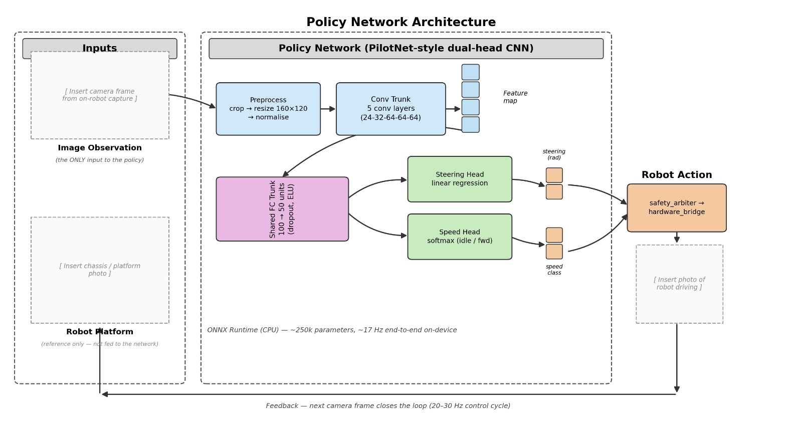

# MobileBot

A camera-only autonomous rover that drives by behaviour cloning, built on the Arduino UNO Q. Submitted to the Arduino Physical AI Challenge India 2026 (Robu.in x Arduino), Robotics & Interactive AI track.

A small CNN looks at the road ahead through a single USB camera and outputs a steering angle and a go/stop decision. A person drove the robot with a gamepad to collect the training data; the trained model now does the driving, with no encoders, lidar or GPS involved.

## Demo

[Watch a 12 s clip of the rover driving](docs/demo.mp4)

## Overview

The UNO Q has two processors, and the project uses each for what it is good at:

- **QRB2210 (Linux, 4x Cortex-A53)** runs ROS 2 Jazzy in Docker: camera, teleop, safety logic, data recording and the neural-network policy. There is no NPU, so inference runs on the CPU with ONNX Runtime.
- **STM32U585 (Zephyr)** runs the real-time firmware: servo and motor output, IMU sampling and the last line of defence, a command watchdog.

The two sides talk through the Arduino Router bridge (MessagePack RPC over UART).

A gamepad on a separate PC publishes `/joy` over Wi-Fi. Everything else runs on the robot.

## Hardware

| Part | Detail |
|---|---|
| Compute | Arduino UNO Q |
| Camera | Arducam USB, MJPEG, 640x480 @ 30 fps |
| Chassis | Ackermann steering, wheelbase 140 mm, track 146 mm |
| Wheels | 64 mm diameter |
| Steering | Servo on pin 9, software-limited to +/-25 deg (mechanical +/-40 deg) |
| Drive motor | SmartElex 15D driver (PWM + DIR, coasts, no active braking), ENA pin 10, DIR pin 11 |
| Feedback | None. Throttle is open loop (no encoder) |
| Speed | Capped at 0.5 m/s, 0.1 m/s used for autonomous driving |
| Operator input | Gamepad on a host PC |

There is no hardware emergency stop. The robot is supervised and lifted by hand if needed. This is listed under limitations.

## Software architecture

```
 host PC                         UNO Q  (Linux, Docker, ROS 2 Jazzy)                    UNO Q  (MCU)
+---------+  /joy   +----------------+   /cmd_drive   +-----------------+  Bridge   +---------------+
| gamepad |-------->| teleop_        |--------------->| hardware_bridge |---------->| mobilebot_mcu |
+---------+         | translator     |        ^       +-----------------+   RPC     | servo, motor, |
                    +----------------+        |                ^   | imu, status     | IMU, watchdog |
                                   +----------+-----+          |   v                +---------------+
 usb_cam --> /image_raw/compressed |  safety_arbiter |<--- policy_node (ONNX)
                  |                +-----------------+
                  v
            data_recorder (MCAP)
```

### ROS 2 packages

| Package | Role |
|---|---|
| `mobilebot_msgs` | Custom messages: `TeleopCommand`, `RobotState`, `McuStatus`, `SessionMetadata` |
| `mobilebot_control` | `teleop_translator` (gamepad to commands) and `safety_arbiter` (mode state machine) |
| `mobilebot_bridge` | `hardware_bridge`, a lifecycle node that owns the link to the MCU |
| `mobilebot_recorder` | `data_recorder`, writes one MCAP bag per episode |
| `mobilebot_policy` | `policy_node`, ONNX inference backend and a benchmark tool |
| `mobilebot_bringup` | Launch files and the parameter file |

### Single writer for motion

Only `safety_arbiter` publishes `/cmd_drive`. Teleop and the policy both send their requests to the arbiter, which decides who is allowed to drive. Modes are `SAFE`, `ARMED_TELEOP`, `ARMED_RECORD`, `ARMED_AUTO` and `FAILSAFE`. Autonomous mode is entered through a service call (`/arbiter/request_auto`) and is refused unless the launch was started with `estop_confirmed:=true`.

### Safety layers

| Layer | Mechanism |
|---|---|
| L0 | Hardware e-stop (not built) |
| L1 | MCU watchdog: 150 ms without a command and the motor stops |
| L2 | Arbiter checks that teleop (150 ms) and policy (300 ms) inputs are fresh |
| L3 | Deadman button must be held |
| L4 | Slew-rate and magnitude limits on steering and throttle |

The MCU latches into `FAILSAFE` on a fault and only clears through an explicit disarm then arm, which the bridge handles.

## Model

A PilotNet-style CNN with about 250k parameters: five convolution layers (24-32-64-64-64), then fully connected layers of 100 and 50 units, with two outputs.

- **Steering head**: regression on the steering angle.
- **Speed head**: two classes, idle and forward.

Input is the camera frame with the top 96 rows cropped off, resized to 160x120, RGB, float32 in [0, 1]. The same preprocessing code is used for training and on the robot, and the exported model carries a contract version string that the policy node checks at startup, so a mismatch fails loudly instead of driving badly.

Training details:

- Turn-weighted L1 loss for steering, class-weighted cross-entropy for speed.
- Straight-driving samples (the +/-5 deg bin) are down-sampled to 35% in the training split.
- Augmentation: horizontal flip with the steering sign negated, brightness jitter, synthetic shadows.
- Train and validation are split by episode, not by frame, so neighbouring frames cannot leak across the split.
- The IMU is deliberately not a model input, to avoid the network learning to copy the previous motion instead of reading the road.

The model is exported to ONNX (opset 17) and checked against the PyTorch output on real frames before it is copied to the robot.



Best validation steering MAE was about 7.3 deg. Offline error is a weak predictor of how the robot behaves on the floor, so this number should be read as a sanity check and not as a score.

## Performance on the UNO Q

Measured with the full stack running (camera, teleop, arbiter, bridge, policy):

| Metric | Result |
|---|---|
| Inference, model alone | about 10 ms |
| Inference, full stack running | about 30-40 ms |
| End-to-end policy loop | about 55-65 ms, 15-18 Hz |
| MCU bridge round trip | 8-90 ms, typically 22-25 ms |

What made a difference:

- ONNX Runtime with `intra_op_num_threads=1` and `inter_op_num_threads=1`, and `cv2.setNumThreads(1)`. With every node competing for four cores, one thread per component was faster than two, even though two was faster in an isolated benchmark.
- The bridge sender thread runs at `SCHED_FIFO` priority, which needs `--cap-add=SYS_NICE`.
- Wi-Fi power saving off (`sudo iw dev wlan0 set power_save off`). With it on, the host-to-robot link added about 35 ms.
- Default Fast DDS. Cyclone DDS was slower on this board.

The raw runs and analysis are in [docs/Benchmarking_Report.txt](docs/Benchmarking_Report.txt).

## Repository layout

```
MCU script/mobilebot_mcu/   STM32 firmware (Arduino sketch)
ROS2 Packages/              ROS 2 workspace packages listed above
Off-Board_tools/            Host-PC tools: extraction, curation, training, export
```

## Setup

### On the robot

Start the container with host networking, the camera and the router socket:

```bash
docker run -it --network=host --cap-add=SYS_NICE \
  --device=/dev/video2 \
  -v /var/run/arduino-router.sock:/var/run/arduino-router.sock \
  -v /mnt/eMMC:/mnt/eMMC \
  ros:jazzy-ros-core
```

Inside the container, install the dependencies (`ros-jazzy-joy`, `ros-jazzy-rosbag2-storage-mcap`, `onnxruntime`, `opencv-python-headless`, `numpy`, `msgpack`). The bridge also needs Arduino's `app_utils` library (see [External dependency](#external-dependency-arduino-app_utils) below).

`usb_cam` needs a fix that is not yet in the released package. The MJPEG branch compares against `"mjpeg"` where it should be `"raw_mjpeg"` ([ros-drivers/usb_cam#346](https://github.com/ros-drivers/usb_cam/issues/346), fixed in [PR #378](https://github.com/ros-drivers/usb_cam/pull/378)). Build `usb_cam` from source with that change.

Put the packages from `ROS2 Packages/` into a ROS 2 workspace's `src/` folder and build it:

```bash
mkdir -p ros2_ws/src && cp -r "ROS2 Packages/"* ros2_ws/src/
cd ros2_ws
# add Arduino's app_utils here first, see "External dependency" below
colcon build --symlink-install
source install/setup.bash
```

Flash `mobilebot_mcu.ino` to the STM32 from the Arduino App environment.

On the host PC, run `joy_node` with `autorepeat_rate:=50.0` on the same `ROS_DOMAIN_ID`.

### Host tools

```bash
cd Off-Board_tools
pip install -e ".[training,dashboard]"
```

### External dependency: Arduino `app_utils`

`hardware_bridge` talks to the MCU through `Bridge` from Arduino's `app_utils` Python library (MPL-2.0, Copyright ARDUINO SRL). It is **not included in this repository**. It ships with the UNO Q's Arduino App environment. Copy that folder into the workspace before building:

```bash
cp -r <path-to-arduino>/app_utils ros2_ws/src/mobilebot_bridge/mobilebot_bridge/app_utils
```

The folder must end up at `ros2_ws/src/mobilebot_bridge/mobilebot_bridge/app_utils/` and contain `__init__.py` and `bridge.py`. If it is missing, `hardware_bridge` falls back to `arduino.app_utils`, which only works where the Arduino package is installed on the system.

## Running

Teleop and recording:

```bash
ros2 launch mobilebot_bringup teleop.launch.py \
  location:=<place> route_id:=<id> surface:=<floor> weather:=<conditions>
```

The hardware bridge is a lifecycle node, so configure and activate it once the launch is up. The deadman button arms the robot. The record button starts and stops episodes while armed.

Autonomous driving:

```bash
ros2 launch mobilebot_bringup teleop.launch.py \
  estop_confirmed:=true use_policy:=true use_recorder:=false
ros2 service call /arbiter/request_auto std_srvs/srv/SetBool "{data: true}"
```

Releasing the deadman or losing a fresh policy command drops the robot out of autonomous mode.

## Training workflow

```bash
mobilebot-extract   <bag_dir>       # MCAP -> parquet + JPEG
mobilebot-merge     <sessions...>   # combine several sessions
mobilebot-validate  <dataset>       # decode every frame, flag problems
mobilebot-curate    <dataset>       # episode-wise train/val split
mobilebot-stats     <dataset>       # steering and speed distribution
mobilebot-train     <dataset>       # training, resumable, early stopping
mobilebot-dashboard                 # live training dashboard (Streamlit)
mobilebot-export    <checkpoint>    # ONNX + metadata sidecar
```

Copy `policy.onnx` and its `.json` sidecar to the path set under `policy_node` in `mobilebot_bringup/config/mobilebot.yaml`.

Recorded data is stored in three layers: raw MCAP bags (one per episode, never modified), derived parquet and JPEG files that can be regenerated at any time, and session metadata (location, route, surface, weather, camera and preprocessing settings) saved as the first message of each bag.

## Results

The robot drove itself in `ARMED_AUTO` for about 3 m on the floor and steered around an obstacle with the deadman held and recording switched off. This is a first working result from a small dataset, not a validated driving performance.

## Limitations

- No hardware e-stop. Runs are supervised.
- Throttle is open loop. The 0.1 m/s autonomous speed is a setpoint, not a measured speed, and `speed_to_throttle` still needs proper calibration.
- Little CPU headroom. The recorder had to be switched off during autonomous runs because `/joy` went stale when the CPU was fully loaded. The root cause is not resolved.
- The training set is small (three sessions, 48 episodes) and from one location.
- The camera field of view and the true full-lock steering angle have not been measured.

## Next steps

- Retrain on the merged sessions and drive longer routes.
- Add wheel encoders for closed-loop speed.
- Add a hardware emergency stop.
- Cut CPU load (composable nodes, a lighter inference runtime) so recording and autonomy can run together.

## Acknowledgements

Arduino and Robu.in for the challenge and the UNO Q hardware. The `usb_cam` maintainers for the MJPEG fix.

## License

Released under the [MIT License](LICENSE). Arduino's `app_utils` is a separate dependency under its own licence (MPL-2.0) and is not part of this repository.

## Author

Praveenbabu R S ([praveenbabu4542@gmail.com](mailto:praveenbabu4542@gmail.com))
